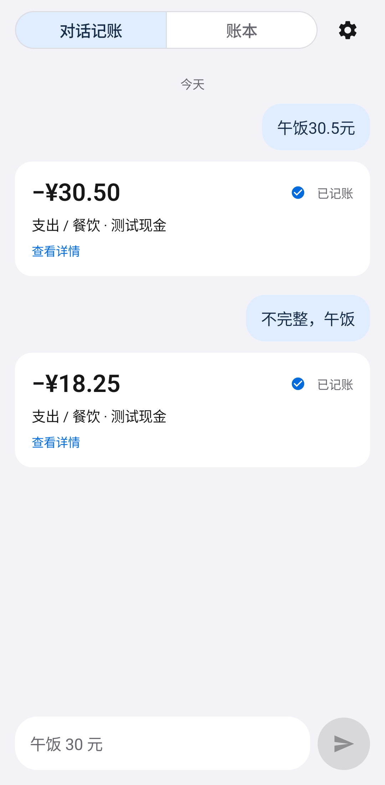
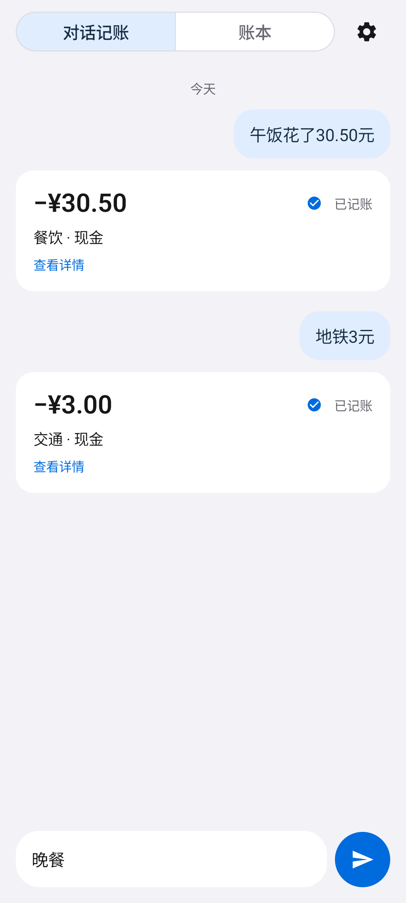
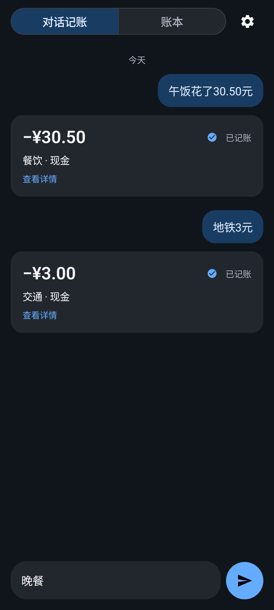
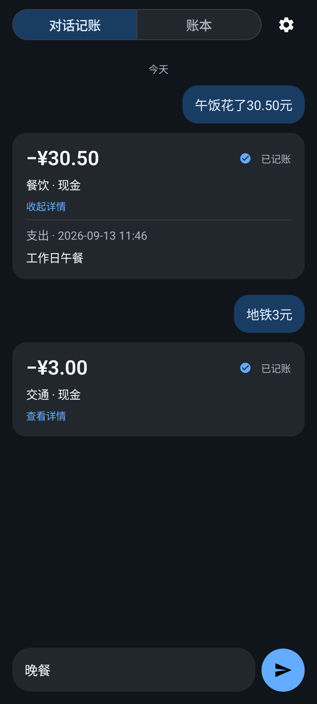
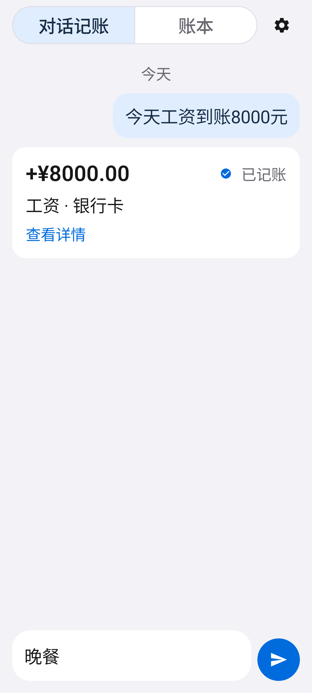
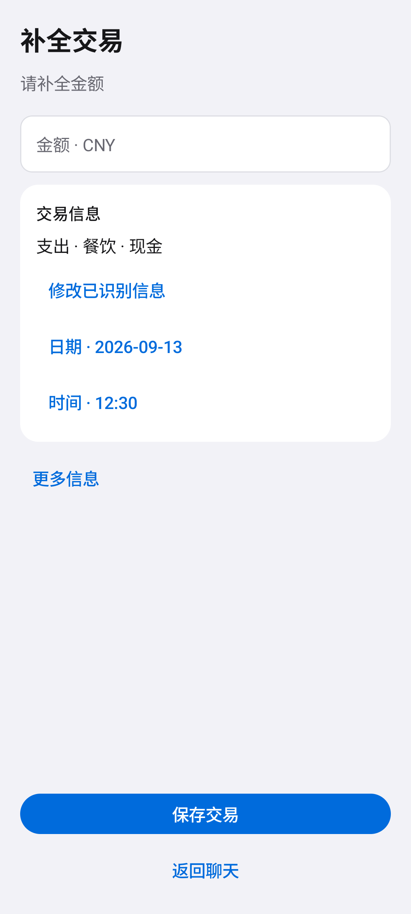
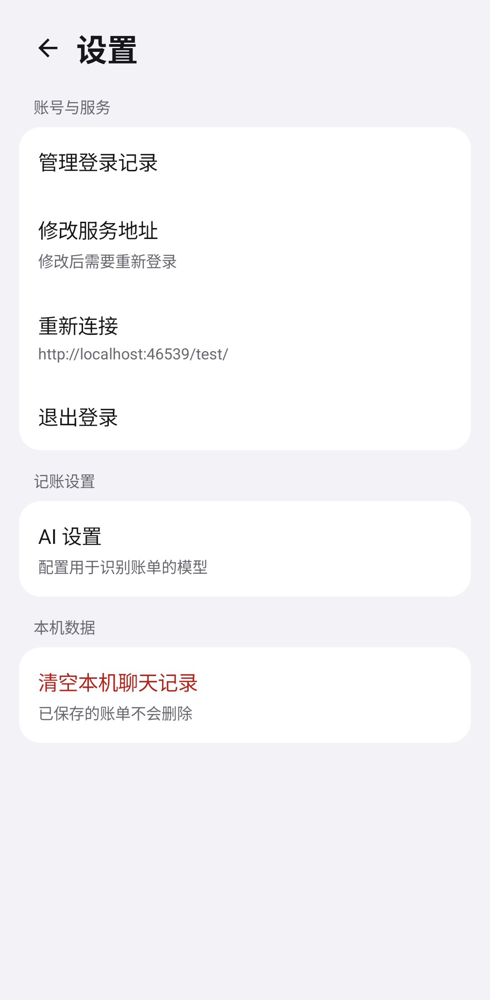
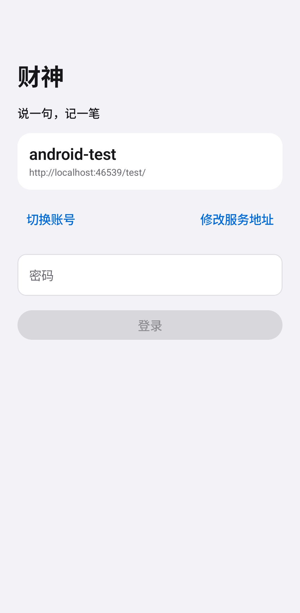

# 安卓 UI 简化验证

本次按评审的 10 项建议依次修改原生安卓界面。保持现有记账、会话、数据保存及 WebView 通信协议。

| 项目 | 最终行为 | 验证依据 |
| --- | --- | --- |
| 1. 合并标题 | 顶部只保留对话/账本切换和设置入口 | AppearanceTest：标题只有一处；实际 App 截图 |
| 2. 简洁收据 | 默认显示金额、分类和账户、保存状态；点击展开类型、时间、备注 | 展开/收起和主题切换测试；退款金额方向测试 |
| 3. 日期分组 | 同一天首次记录显示日期，跨天重新显示 | 同日与跨日测试 |
| 4. 统一日夜布局 | 共用导航、卡片和输入区布局，仅更换主题色 | 两种主题截图、发送按钮位置相等断言、展开状态保留 |
| 5. 突出输入 | 无底部分隔线，柔和输入底色，56dp 发送图标，空输入不可发送 | 截图、空输入禁用测试、实际自动记账测试 |
| 6. 异常才提示 | 不常驻正常连接说明；异常提示原因并提供重试，恢复后消失 | ChatFlowTest：模拟 503、单个重试入口、恢复后消失 |
| 7. 优先补全 | 默认只显示缺失项；已识别项可展开修改；备注和标签收起；日期时间使用系统选择器 | TransactionEditorUiTest：缺失类型、金额精度、日期时间保存、标签修改、提交 ID 保留 |
| 8. 分组设置 | 账号与服务、记账设置、本机数据；修改服务地址与退出分别操作 | 设置页截图；HybridFlowTest：往返设置后网页草稿保留 |
| 9. 简洁登录 | 老用户显示账号摘要与密码；可切换账号、使用其他账号、展开服务配置；首次登录显示必填配置 | ChatFlowTest：登录、双重验证、历史修改/删除、重建、密码清空 |
| 10. 精简文案 | 登录与空白页保留核心引导；未知保存状态使用“查看账单” | 登录截图、未知状态只读核实测试、源码检查 |

## 验证结果

- 构建：`assembleDebug`、`assembleDebugAndroidTest` 成功。
- 单元测试：21 项通过（金额与交易规则 12、接口 7、账本来源规则 2）。
- 安卓测试：12 项通过（ChatFlowTest 1、AppearanceTest 4、TransactionEditorUiTest 2、HybridFlowTest 1、LoginHistoryTest 3、StorageTest 1）。
- `lintDebug` 通过；项目仍有已有的同步 SharedPreferences、WebView 功能检查及依赖版本建议等警告，没有错误。
- 在专用 `emulator-5554` 上使用 MockWebServer 测试；没有连接个人账本，也没有安装到实体手机。
- 人工检查默认字号、1.5 倍字号、深浅色、收据展开、登录、设置与补全界面截图，没有发现所测画面中的重叠或裁切。未据此声明完整无障碍合规。

构建与测试输出保存在同目录的 `build.txt`、`ui-tests.txt`、`hybrid-tests.txt`。

## 截图

实际 App 登录并记账：

同一组件的日间与夜间状态：

